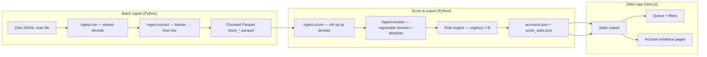

# Architecture

Attack-surface sales intelligence: stream a Shodan-style scan, resolve **buyer companies** (not hosting ISPs), score explainable cyber need, and ship a static rep queue.

## End-to-end flow



In production terms, **one monthly scan file** = one `--batch-id`, one Parquet directory under `data/parquet/`, one scoring run. The web app only consumes the latest compact export.

## Modules

| Path | Responsibility |
| --- | --- |
| `ingest/run.py` | Stream zstd JSONL; never load full dump in RAM; write `hosts_NNNNN.parquet` chunks |
| `ingest/extract.py` | Map raw banner JSON → typed host row (vulns, WAF, EOL, dangerous ports, `security.txt`) |
| `ingest/resolve.py` | `tldextract` registrable domain; drop PTR/reverse-DNS, CDN suffixes, ISP umbrellas |
| `ingest/score.py` | Aggregate hosts → company; `fit_multiplier` gate; weighted score + evidence caps |
| `ingest/config.py` | Denylists, dangerous service hints, scoring weights, export thresholds |
| `ingest/pipeline.py` | Optional one-shot: ingest + score + write JSON outputs |
| `eval/sample_gold.py` | Stratified 100-row sample for human review |
| `eval/hand_label.py` | Independent SDR-style labels on gold sample |
| `eval/metrics.py` | Precision@K, noise leak, gold agreement → `metrics.json` |
| `app/` | Next.js App Router, `output: "export"` for Vercel |

## Entity resolution (why this exists)

Each scan line is **IP + port + banner**. Shodan’s `org` field usually names the **hoster** (`OVH SAS`, `Amazon`), not the company running the app.

Resolution steps:

1. Collect `hostnames` and `domains` from the banner.
2. Derive a **registrable domain** (`company.co.uk`), not a cloud hostname.
3. Reject junk suffixes (CDN, hyperscaler shared infra, telco reverse-DNS patterns).
4. Roll all surviving hosts into one **account** keyed by that domain.

Accounts that are honeypot-only, CDN-only, ISP reverse-DNS umbrellas, or provider aggregates get **fit = 0** and never export.

## Scoring model

Two layers:

1. **Urgency** — capped sum of rule weights from material findings (CVE severity bands, EPSS, EOL, dangerous exposures, IoT, self-signed TLS, HTTP risk without WAF, etc.). CVEs are counted by **severity band**, not every CPE ID in the banner.
2. **Fit multiplier** — `named_business` (1.0) down to `hosted_named_domain` (0.85), or **0** for non-ICP footprints.

`score = min(100, round(urgency × fit))`. Decisions: `call_now` ≥ 55, `watch` ≥ 28, else `low`. Export cutoff: `MIN_SCORE_EXPORT` (default 12), cap `MAX_ACCOUNTS_EXPORT`.

Evidence rows (IP, port, product, CVE text) are stored per account with a hard cap so JSON stays deployable.

## Web application

- **Input:** `app/data/accounts.json` (~7.8k accounts for the 800k-record prototype batch).
- **Build:** `npm run build` generates thousands of static account routes via `generateStaticParams`.
- **Deploy:** Vercel with project root `app/`; no server-side database at runtime.

Pages: home queue (`Queue.tsx` filters), account detail (evidence + breakdown), method (scoring narrative + batch stats).

## Evaluation (no ground-truth conversions)

The scan has no “bought cybersecurity” labels. We measure:

- **Precision@50 / @100** against `auto_label` (named buyer + material risk).
- **Noise leak** in top 100 (CDN/cloud PTR domains).
- **Gold agreement** — 100 stratified accounts, hand labels in `eval/hand_label.py` vs auto labels.
- **Determinism** — re-run `ingest.score` on the same Parquet → identical scores.

No LLM in the scoring path (deterministic, auditable rules).

## Operational commands

```bash
# Ingest only
python -m ingest.run --input b2_download_file_by_id --out data/parquet --batch-id 2026-03

# Score existing Parquet
python -m ingest.score

# Full pipeline
python -m ingest.pipeline --input b2_download_file_by_id --batch-id 2026-03

# Eval
python -m eval.sample_gold
python -m eval.metrics
```

Full-file ingest: omit `--max-records`. Prototype numbers in README use **800,000** records; architecture is unchanged at full scale.

## What belongs in git

See root `.gitignore`. In short:

| Commit | Do not commit |
| --- | --- |
| Source: `ingest/`, `eval/`, `app/` (except build dirs) | Raw scan (`b2_download_file_by_id`, `*.zst`) |
| `app/data/accounts.json` (precomputed queue) | `data/parquet/`, `*.parquet`, QA chunks |
| `data/score_stats.json`, `eval/gold.json`, `eval/metrics.json` | `app/node_modules/`, `app/.next/`, `app/out/` |
| `requirements.txt`, `README.md`, this file | `.venv/`, secrets, local debug scripts |

Regenerate Parquet and static `out/` on each machine; the hosted demo relies on committed `accounts.json` + a fresh Vercel build.
